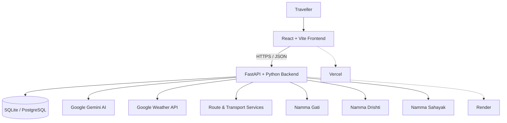

<div align="center">

# ನಮ್ಮ ಪ್ರಯಾಣ · NammaPrayana

### Explore. Taste. Travel. — Discover Karnataka beyond the ordinary.

**An AI-powered, accessibility-aware travel companion for Karnataka.**

[](https://nammaprayana.vercel.app)
[](https://nammaprayana.vercel.app)
[](https://nammaprayana-api.onrender.com)
[](https://nammaprayana-api.onrender.com/docs)

*Built for the Kannada Digital Innovation Hackathon 2026*

</div>

---

## The idea

Karnataka is more than a checklist of famous monuments. It is a mix of royal cities, ancient temples, coastlines, Western Ghats, regional food, local traditions and places that deserve to be discovered at a traveller's own pace.

Planning that kind of journey can mean jumping between maps, attraction lists, food blogs, accommodation sites, weather apps and translation tools. For travellers with children, older adults, pregnancy-related needs or mobility considerations, a generic itinerary can also be impractical.

**NammaPrayana brings these planning steps together in one Karnataka-focused experience.** It helps travellers choose destinations and attractions, generate a personalised itinerary, explore local food and stays, check available weather forecasts, and access practical Kannada assistance along the way.

> **NammaPrayana means “Our Journey.”** The project aims to make exploring Karnataka easier, more personal and more accessible—while encouraging travellers to look beyond the obvious stops.

## Try the live demo

**Live application:** [nammaprayana.vercel.app](https://nammaprayana.vercel.app)  
**API health:** [nammaprayana-api.onrender.com](https://nammaprayana-api.onrender.com)  
**Interactive API documentation:** [Open Swagger UI](https://nammaprayana-api.onrender.com/docs)

### Demo login

Use this account to explore the demo, if it is available in the currently deployed database:

| Field | Demo value |
|---|---|
| Username | `Test` |
| Password | `Test12345` |

This is a shared demonstration account, not a personal account. Do not enter personal, confidential or payment information. Demo account availability depends on the deployed database; if the credentials are not accepted, use the sign-up flow where available.

---

## What makes NammaPrayana different?

NammaPrayana is not just an itinerary generator. Its differentiator is the **combination of destination discovery, preference-aware planning, practical local assistance and accessibility-conscious pacing** in a single Karnataka-focused workflow.

### Key capabilities

| Feature | What it does | Why it matters |
|---|---|---|
| **AI itinerary planning** | Generates a day-by-day plan using selected destinations, travel dates, traveller count, interests, budget, travel style and selected attractions. | Turns a collection of places into a trip shaped around the traveller. |
| **Curated destination & attraction discovery** | Helps travellers explore Karnataka destinations and choose attractions, including must-visit places where curated data is available. | Keeps planning grounded in specific places rather than a generic travel prompt. |
| **Namma Gati — adaptive pacing** | Evaluates itinerary stops against pace and traveller needs, including senior citizens, children, pregnancy-related needs, mobility/accessibility needs and lower-walking preferences. | Encourages a more manageable itinerary instead of packing in as many stops as possible. |
| **Namma Drishti — visual assistance** | Accepts an image containing text and uses AI-assisted text extraction and translation to help travellers understand it. | Supports travellers when they encounter unfamiliar local-language text. |
| **Namma Sahayak — local-language help** | Offers scenario-based practical phrases and travel assistance, with Kannada phrase audio playback. | Helps users prepare for everyday interactions such as transport, shopping and food. |
| **Weather explorer** | Retrieves daily forecasts from Google Weather API for supported destinations and dates. | Helps travellers consider weather before outdoor activities. |
| **Local food discovery** | Surfaces regional food spots and local dining suggestions where data is available. | Adds food and local discovery to the itinerary-planning process. |
| **Stay recommendations** | Recommends accommodation options based on the chosen destinations, dates, travel style and budget. | Helps travellers explore possible places to stay; prices and availability must be confirmed. |
| **Route discovery & intercity information** | Connects trip planning with route details and supported transport information. Some modes depend on configured providers and available data. | Keeps travel between destinations in view, not just the attractions themselves. |
| **Saved itineraries & authentication** | Supports account login and saving/reopening itineraries. Google sign-in is available when configured. | Helps travellers return to their plans rather than rebuilding them each time. |
| **Multilingual interface** | Provides English, Hindi and Kannada interface strings where translations have been implemented. | Makes the application more approachable for a wider set of travellers. |

### A practical end-to-end journey

1. **Choose your destinations** in Karnataka.
2. **Select attractions** and provide your dates, group size, budget, interests and travel style.
3. **Generate your itinerary** and review its day-by-day stops.
4. **Adapt the pace** for your group's preferences with Namma Gati and itinerary adjustments.
5. **Check weather, food, stays and route information** as part of the planning experience.
6. **Use Namma Sahayak and Namma Drishti** for practical language and visual assistance.
7. **Save the itinerary** to revisit it later when logged in.

---

## Product modules

### 1. Plan Your Journey

Build a personalised Karnataka trip with multiple destinations, travel dates, selected attractions, interests, group size, budget and travel style. The backend combines curated destination/attraction data with AI-generated itinerary planning. Selected attractions are passed into the itinerary request so the planner can prioritise the traveller's choices.

### 2. Namma Gati — thoughtful pacing

Namma Gati is the project's pacing and accessibility-aware planning layer. It can take traveller profiles and preferences into account and help distribute stops at a more suitable pace. It is a planning aid, not a medical or accessibility certification; travellers should confirm site conditions with relevant providers.

### 3. Namma Drishti — understand what you see

Namma Drishti accepts an image and helps extract and translate text through the configured AI vision service. Image input is limited to supported formats, with a 10 MB image limit on the documented translation endpoint. The results are intended as assistance; travellers should verify critical information such as safety instructions, medicine labels or official notices.

### 4. Namma Sahayak — useful Kannada, in context

Namma Sahayak includes curated phrase scenarios and a free-text travel-help flow. Kannada phrase audio is returned as MP3 by the backend; Google Cloud Text-to-Speech can be configured as the preferred provider, with the current fallback path described in the environment section. Audio-provider availability depends on the deployment and network access.

### 5. Weather explorer — forecasts with clear limits

Weather forecasts use the **Google Weather API**. Forecasts are available for up to 10 days from the current day. If requested trip dates fall outside the returned forecast horizon, the app should display available real forecasts and a notice for dates without data rather than inventing conditions. Forecast availability and accuracy are subject to the upstream provider.

### 6. Food, stays and routes

Food discovery and accommodation recommendations help round out the trip. Route and transport information depends on the supported provider and configured API keys. NammaPrayana is a planning companion; do not assume that a suggested stay is available or that a route result represents a confirmed ticket or booking.

---

## Architecture



### Technology stack

| Layer | Technologies |
|---|---|
| Frontend | React 18, Vite, JavaScript, React Router, Lucide icons, custom CSS |
| Backend | Python, FastAPI, Pydantic, HTTPX |
| Data layer | SQLAlchemy; SQLite for a simple local setup, PostgreSQL when `DATABASE_URL` is configured |
| AI | Google Gemini / Gemini Vision through the Google GenAI SDK |
| Weather | Google Maps Platform Weather API |
| Speech | Backend MP3 endpoint; optional Google Cloud Text-to-Speech |
| Maps & route data | Configurable Google Maps/Routes integration and supported route providers |
| Railway data | RailRadar API integration, subject to API configuration and provider availability |
| Deployment | Vercel frontend, Render backend |

---

## Run locally

These instructions target Windows PowerShell. Commands should be run from the repository root unless stated otherwise.

### Prerequisites

- Git
- Node.js and npm compatible with the Vite version in `frontend/package.json`
- Python 3.12 or a compatible Python version supported by the project's dependencies
- API credentials for the external services you intend to test

### 1. Clone the repository

```powershell
git clone https://github.com/VaibhavCodes26/NIE_HACKATHON.git
cd NIE_HACKATHON
```

### 2. Configure backend environment variables

Create a local backend environment file from the template:

```powershell
Copy-Item .env.example backend/.env
```

Edit `backend/.env` and add the credentials for the services you want to use. At minimum, configure the **Google Gemini API key** for AI-powered functionality and **Google Weather API key** for forecasts. Keep this file local; never commit real credentials.

The backend loads `backend/.env` at startup. The root `.env.example` is a template, not a secrets file.

### 3. Install and start the backend

```powershell
cd backend
python -m venv .venv
.\.venv\Scripts\Activate.ps1
python -m pip install --upgrade pip
pip install -r requirements.txt
python -m app.seed
uvicorn app.main:app --reload --host 127.0.0.1 --port 8000
```

The API should be available at:

- API root: <http://127.0.0.1:8000/>
- Swagger UI: <http://127.0.0.1:8000/docs>
- ReDoc: <http://127.0.0.1:8000/redoc>

`python -m app.seed` creates the tables and inserts starter destination/attraction data. It is designed to avoid duplicating existing records when run again.

### 4. Install and start the frontend

Open a second PowerShell terminal from the repository root:

```powershell
cd frontend
npm install
npm run dev
```

Vite normally serves the application at <http://localhost:5173>.

For a production build:

```powershell
npm run build
```

The output is generated in `frontend/dist/`. Do not commit generated build output unless the deployment workflow specifically requires it.

---

## Environment variables

Only set the credentials for the features you plan to run. Variable names below match the project's example environment files.

| Variable | Purpose | Required? |
|---|---|---|
| `GEMINI_API_KEY` | Gemini-powered itinerary generation and AI features | Required for Gemini-dependent features |
| `GEMINI_MODEL` | Text-generation model name | Optional; uses the configured default when omitted |
| `GEMINI_VISION_MODEL` | Vision model for image understanding | Optional override; needed for Drishti's configured vision flow |
| `GOOGLE_WEATHER_KEY` | Google Weather API daily forecasts | Required for weather forecasts |
| `GOOGLE_TTS_API_KEY` | Google Cloud Text-to-Speech; if configured, used for Kannada phrase audio | Optional in the current setup |
| `ROUTES_API_KEY` | Google Routes API integration where used | Optional; required for the corresponding configured route calls |
| `MAPS_JS_API_KEY` | Google Maps JavaScript integration where used | Optional; set if the map integration needs it |
| `RAILRADAR_API_KEY` | RailRadar station/train endpoints | Optional; required for provider-backed railway responses |
| `SESSION_SECRET` | Authentication/session-related secret | Configure a strong random value for deployment |
| `GOOGLE_CLIENT_ID` | Google OAuth client ID | Optional; required for Google sign-in |
| `GOOGLE_CLIENT_SECRET` | Google OAuth client secret | Optional; required for backend Google OAuth flow |
| `FRONTEND_URL` | Allowed production frontend origin for CORS | Set for deployment |
| `CORS_ORIGINS` | Additional comma-separated allowed frontend origins | Optional |
| `DATABASE_URL` | Database connection URL; supports PostgreSQL configuration | Optional; local SQLite is the default |
| `ENVIRONMENT` | Controls production-specific behaviour such as secure cookies | Set to `production` in deployment |

For local development, use `http://localhost:5173` for the frontend and `http://127.0.0.1:8000` for the backend unless your setup uses different ports.

### Deploying the API on Render

1. Create or open the `nammaprayana-api` web service.
2. Configure the Python build/start commands according to the service settings; the application entry point is `app.main:app` from the `backend` directory.
3. Add the required variables from the table above in **Render → Service → Environment**. Never add the actual API keys to GitHub.
4. Set `FRONTEND_URL` to `https://nammaprayana.vercel.app` and set any additional allowed origins with `CORS_ORIGINS` if needed.
5. Save the environment configuration and deploy/restart the service.
6. Verify the API root and `/docs` after deployment.

### Deploying the frontend on Vercel

1. Import the repository into Vercel.
2. Set the project **Root Directory** to `frontend`.
3. Use `npm install` (or the platform's lockfile-based install) as the install step and `npm run build` as the build command.
4. Set the output directory to `dist`.
5. Configure the frontend's API base URL using the environment variable supported by `AuthContext.jsx` (`VITE_API_BASE_URL` or `VITE_API_URL`) and point it at the deployed backend, e.g. `https://nammaprayana-api.onrender.com`.
6. Deploy and test the frontend-to-backend flow.

The repository includes a root `vercel.json` rewrite configuration for client-side routes. Keep API keys and server-side secrets out of all `VITE_` variables because frontend environment variables are bundled into browser-accessible assets.

---

## API overview

The FastAPI application exposes interactive documentation at `/docs`. Important API groups include:

| Endpoint | Method | Purpose |
|---|---|---|
| `/` | `GET` | API status / welcome response |
| `/api/destinations` | `GET` | List active destinations |
| `/api/destinations/{destination_id}/attractions` | `GET` | Attractions for a destination |
| `/api/itineraries/generate` | `POST` | Generate an itinerary from trip preferences |
| `/api/weather/forecast` | `GET` | Daily Google Weather forecast for a destination or coordinates |
| `/api/gati/plan` | `POST` | Build an adaptive pacing plan |
| `/api/drishti/translate` | `POST` | Upload an image and translate extracted text |
| `/api/drishti/scan` | `POST` | Scan a data-URL image and translate extracted text |
| `/api/sahayak/scenarios` | `GET` | List phrasebook scenarios |
| `/api/sahayak/phrases?scenario=...` | `GET` | Fetch phrases for a selected scenario |
| `/api/sahayak/ask` | `POST` | Ask the travel-help service a question |
| `/api/sahayak/tts?text=...` | `GET` | Return Kannada phrase audio as MP3 |
| `/api/auth/signup` | `POST` | Create an account |
| `/api/auth/login` | `POST` | Log in with username and password |
| `/api/auth/logout` | `POST` | End the current session |
| `/api/itineraries/saved` | `GET`, `POST` | List or save the current user's itineraries |
| `/api/itineraries/saved/{itinerary_id}` | `GET`, `DELETE` | Read or delete a saved itinerary owned by the user |
| `/api/trains/stations?q=...` | `GET` | Search railway stations through the configured provider |
| `/api/trains/between?from=...&to=...` | `GET` | Search provider-backed trains between station codes |

Some endpoints require authentication, configured API keys or upstream provider availability. Check `/docs` for request schemas and the deployed API for current status.

---

## Testing and quality checks

Run commands from the `backend` and `frontend` directories as appropriate.

### Backend tests

```powershell
cd backend
python -m pip install pytest
python -m pytest -q
```

Tests that cover external APIs should mock upstream calls rather than require live provider access, unless a test explicitly states otherwise.

### Frontend production build

```powershell
cd frontend
npm install
npm run build
```

A successful Vite build verifies that the frontend can be bundled; it does not replace browser-based checks of login, itinerary generation, weather display, images, audio or other external integrations.

### Suggested final demo checklist

- Sign in using the demo account or register a test account.
- Generate a trip with more than one destination and select a few attractions.
- Confirm the generated itinerary reflects dates and selected places.
- Try a slower pace or an accessibility-related preference in Namma Gati.
- Request weather within the available forecast window and check the notice when dates exceed it.
- Open Namma Drishti with a supported image.
- Play a Kannada phrase in Namma Sahayak.
- Save an itinerary, revisit it from the saved-itineraries area, and verify that it remains available.
- Check the browser console and backend logs for errors.

---

## Responsible use, limitations and data accuracy

- **Weather has a finite horizon.** Forecasts are available for up to 10 days from today. Dates without provider data are identified; the app should not fabricate weather values for them.
- **Stay details are recommendations, not reservations.** Confirm room availability, current price, location and terms with the property or booking provider.
- **Transport information is not a confirmed ticket.** Live booking and availability depend on external providers and may not be available for every mode or route.
- **AI output needs judgement.** Confirm opening hours, access requirements, local conditions, prices and safety-critical details before travelling.
- **Accessibility is individual.** Namma Gati helps make planning more considerate; it cannot certify that a site is accessible or provide medical advice.
- **Images and translations can be imperfect.** Verify critical text with an official source or a trusted local person.
- **API keys belong on the server.** Never expose Gemini, Google Weather, Text-to-Speech, Railway or other private keys in frontend code or commit them to the repository.
- **Demo credentials are public demo credentials.** Do not reuse them for real accounts or sensitive activity. Rotate or disable the demo account when the public demonstration is no longer needed.

---

## Roadmap

These are potential next steps, not claims that they are already live:

- Live accommodation availability and deeper hotel/hostel partnerships.
- In-app booking integrations for trains, buses, taxis and stays, subject to partner APIs, permissions and commercial agreements.
- Verified attraction hours, closures, accessibility details and visitor feedback.
- Feedback-driven recommendations that learn which types of places a traveller prefers.
- More complete Kannada, Hindi and English coverage across destination content and interface copy.
- Better offline/low-connectivity support for essential phrases and saved plans.
- A partner model for local businesses, with transparent sponsored listings and clear separation from organic recommendations.

---

## Repository structure

```text
NIE_HACKATHON/
├── backend/
│   ├── app/
│   │   ├── main.py                 # FastAPI app and core endpoints
│   │   ├── database.py             # SQLAlchemy database configuration
│   │   ├── models.py               # Database models
│   │   ├── schemas.py              # Request/response schemas
│   │   ├── seed.py                 # Starter destination and attraction data
│   │   ├── routes/                 # Auth, saved trips, Gati, Drishti, Sahayak, trains
│   │   └── services/               # AI, weather, stays, routing and TTS services
│   ├── requirements.txt
│   └── .env.example
├── frontend/
│   ├── src/
│   │   ├── components/             # Shared UI components
│   │   ├── data/                   # Destination data, translations and assets metadata
│   │   ├── utils/                  # Route and helper utilities
│   │   ├── ItineraryPage.jsx       # Itinerary, weather, stays and budget view
│   │   ├── RouteDiscovery.jsx      # Attraction and route discovery
│   │   ├── SahayakPage.jsx         # Travel phrasebook and assistance
│   │   └── ...                     # Remaining pages and app components
│   ├── package.json
│   └── README.md
├── .env.example
├── vercel.json
└── README.md
```

---

## Contributing

Contributions, bug reports and practical suggestions are welcome. For substantial changes, open an issue or discuss the intended behaviour before sending a pull request. Keep changes focused, add or update tests when behaviour changes, and never include real `.env` files, credentials, local databases, generated build output or Python cache files in commits.

## Acknowledgements

NammaPrayana brings together open-source frontend and backend tooling, Google AI and weather services, configured route/railway providers, and publicly attributed destination imagery. Credits and licences for Wikimedia Commons photographs should be checked on each original file page before reuse.

---

<div align="center">

### Karnataka has many stories. Let your next journey find one.

**NammaPrayana — ನಮ್ಮ ನಾಡು · ನಮ್ಮ ಪ್ರಯಾಣ**

[Explore the live demo](https://nammaprayana.vercel.app) · [API documentation](https://nammaprayana-api.onrender.com/docs) · [Source code](https://github.com/VaibhavCodes26/NIE_HACKATHON)

</div>
